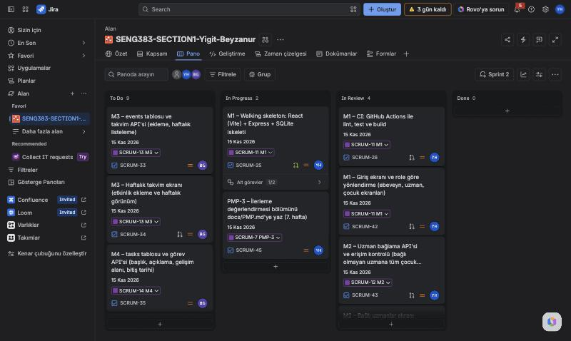
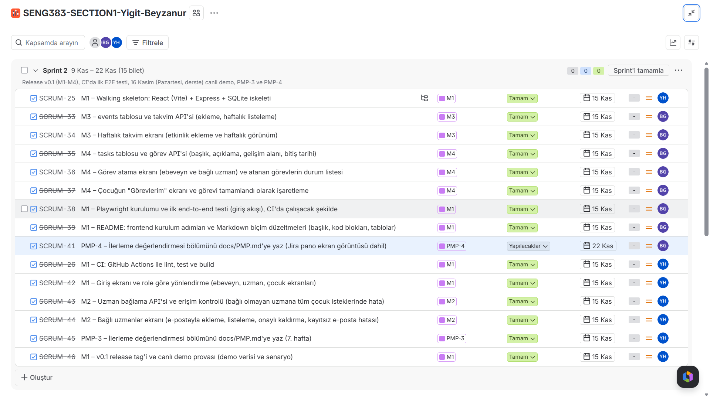

# Project Management Plan (PMP)

> The purpose of this PMP is to practice planning and tracking work in Jira. Keep it short: most of the content is a summary of what you set up in Jira.
> Keep this file at `docs/PMP.md`. Each section is one Jira epic (PMP-1 … PMP-6); mark the epic Done when the section is complete.
> Save screenshots in `docs/img/`.

| Section | Content | Required by |
|---|---|---|
| PMP-1 | Project, Jira setup, team and roles | Week 6 |
| PMP-2 | Work packages (epics) and sprint plan | Week 6 |
| PMP-3 | Progress review: mid-term (v0.1) | Mid-term evaluation (Week 8 / 9) |
| PMP-4 | Progress review: v0.2 | Week 10 |
| PMP-5 | Progress review: final (v1.0) | Final evaluation |
| PMP-6 | Retrospective | Final evaluation |

---

## PMP-1. Project and Team

### Project and Jira Setup

**Project in one sentence:** A web-based decision support platform where parents and specialists share one schedule, task list and observation record, with an AI component that summarizes the records for each role but never makes decisions.
**Jira project key:** SCRUM
**Jira board link:** https://seng383-section1-g4.atlassian.net/jira/software/projects/SCRUM/boards/1

### Team and Roles

| Name | Jira / GitHub username | Role |
|---|---|---|
| Yiğit Ahmet Hosta | Yiğit Ahmet Hosta / Yigithosta | Full-stack developer and Jira/GitHub admin. Owns M1, M2, M5, M8, the design document and CI. PMP-1, PMP-3, PMP-5. |
| Beyza Nur Güngör | Beyza Nur Güngör / beyza21b | Full-stack developer. Owns M3, M4, M6, M7, the SRS and the end-to-end tests. PMP-2, PMP-4, PMP-6. |

Both members review and approve each other's pull requests; `main` requires one approval before merging.

---

## PMP-2. Plan

### Work Packages (Epics)

| Epic | Owner | Number of tasks | Planned sprint(s) |
|---|---|---|---|
| M1 | Yiğit Ahmet Hosta | 7 | Sprint 1–2 |
| M2 | Yiğit Ahmet Hosta | 2 | Sprint 2 |
| M3 | Beyza Nur Güngör | 2 | Sprint 2 |
| M4 | Beyza Nur Güngör | 3 | Sprint 2 |
| M5 | Yiğit Ahmet Hosta | 0 (planned) | Sprint 3 |
| M6 | Beyza Nur Güngör | 0 (planned) | Sprint 3 |
| M7 | Beyza Nur Güngör | 0 (planned) | Sprint 3 |
| M8 | Yiğit Ahmet Hosta | 1 | Sprint 3 |

M1 tasks are shared: setup, README and the end-to-end tests are owned by Beyza Nur Güngör.

### Sprint Plan

| Sprint | Weeks | Sprint goal | Ends with |
|---|---|---|---|
| Sprint 1 | Weeks 5–6 (26 Oct – 8 Nov) | Jira and GitHub setup, SRS and design document first version, PMP-1 and PMP-2 | Walking skeleton (v0.0), Week 6 |
| Sprint 2 | Weeks 7–8 (9 – 22 Nov) | M1–M4, first end-to-end test in CI, live demo, PMP-3 and PMP-4 | Release v0.1, mid-term |
| Sprint 3 | Weeks 9–10 (23 Nov – 6 Dec) | M5–M8, end-to-end tests for 3 critical flows, final SRS and design, PMP-5 | Release v0.2, Week 10 |
| Sprint 4 | Weeks 11–12 (7 – 20 Dec) | End-to-end test for each module, final report, PMP-6, presentation | Release v1.0, final |

---

## PMP-3. Progress Review: Mid-term (v0.1)

Status on 13 November 2026, the end of week 7 and the middle of Sprint 2. Release v0.1 (M1–M4) is shown live in class on Monday 16 November.

**Jira board screenshot:** Sprint 2 board on 13 November.

| Epic | Planned for this point | Status (Done / In progress / Not started) |
|---|---|---|
| M1 – Login and roles | Walking skeleton (v0.0), seed data, JWT login API, login screen with role-based routing, CI with tests and build, README, first end-to-end test | In progress. Walking skeleton, seed and `v0.0` done. JWT login API (PR #9), CI (PR #12) and login screen (PR #13) in review. README update and Playwright test not started. |
| M2 – Linking specialists | Link API with access control, linked specialists screen | In progress. Both in review: API (PR #10) and screen (PR #14). |
| M3 – Weekly schedule | Events table and API, weekly schedule screen | Not started |
| M4 – Tasks | Tasks table and API, task assignment screen, child's "My tasks" screen | Not started |
| M5 – M8 | Planned for Sprint 3 | Not started, as planned |
| SRS | First version (week 6) | First version done. Template fixes moved to Sprint 3. |
| DESIGN | First version (week 6) | First version done. Final version due in week 10. |
| PMP-1, PMP-2 | Project, team, work packages and sprint plan | Done |
| PMP-3 | This section | In progress until this pull request is merged |

**Sprint 2 in numbers:** 16 tasks: 6 in review (including this PMP-3), 1 in progress (SCRUM-25, the parent of the JWT task) and 9 not started. Sprint 1 closed with 8 tasks done and 8 pull requests merged.

**Changes to the plan (if any):**
- **Demo date.** The live demo is on Monday 16 November, in the first class of week 8, not at the end of Sprint 2 (22 November). The due date of every v0.1 task is now 15 November.
- **New tasks.** Sprint 2 got five new tasks:
  - SCRUM-42: M1 login screen.
  - SCRUM-43: M2 link API and access control.
  - SCRUM-44: M2 linked specialists screen.
  - SCRUM-45: PMP-3.
  - SCRUM-46: the v0.1 release tag and demo rehearsal.

  M1 now has 8 tasks instead of 7.
- **Moved.** SCRUM-40 (SRS template fixes) moved to Sprint 3. It does not block the demo.
- **Dependencies in Jira.** "Blocks" links show the order of the work. For example, the M3 and M4 APIs wait for the JWT login API and access control, and the M3 and M4 screens wait for the login screen.
- **Review column in use.** A task moves to "In Review" when its pull request is open. GitHub for Jira shows each task's branch, commits, pull request and CI build. Pull requests that depend on each other are stacked (#9 → #10 → #13 → #14), so work did not wait for each review.

**Risk:** M3 and M4 have not started two days before the demo. Their APIs need the JWT login API and access control, so reviewing PR #9 and PR #10 is the first step for both members.

---

## PMP-4. Progress Review: Week 8 (v0.1)
**Review date:** 21 November 2026

**Sprint:** Sprint 2, Weeks 7–8 (9–22 November 2026)

**Release:** v0.1 (M1–M4)
### 1. Release Progress and Acceptance Criteria

The v0.1 mid-term release was integrated into the main branch and tagged as `v0.1` at commit `59243b7`.

| Epic | Planned deliverables | Acceptance criteria status |
|---|---|---|
| M1 – Login and roles | JWT authentication, demo accounts, role-based routing, CI, README and E2E tests | Implemented and merged. Login and role-routing scenarios passed local E2E tests. |
| M2 – Linking specialists | Specialist linking API, access control, SpecialistsPage, confirmation before unlinking | Implemented and merged. Specialist UI tests passed. |
| M3 – Weekly schedule | Events API, weekly schedule UI, role-based access | Implemented and merged. Events API and schedule UI tests passed. |
| M4 – Tasks | Tasks API, assignment UI, child's My Tasks page | Implemented and merged. Task management tests passed. |

All four planned modules were included in the v0.1 codebase.

### 2. Testing and Continuous Integration

Testing was performed throughout Sprint 2 using Jest, Supertest, Vitest and Playwright.

| Test area | Last locally verified result | Purpose |
|---|---|---|
| Backend | 102 tests passed across 7 suites | Authentication, access control, specialists, events, tasks, seed and health |
| Frontend | 39 tests passed across 6 files | Login, role-based navigation, specialists, schedule and tasks |
| Playwright E2E | 3 tests passed | Parent login, invalid credentials and child navigation |

The Playwright tests use Chromium and start the application with an isolated temporary SQLite database.

GitHub Actions was configured to run automated tests and the frontend build for pull requests targeting `main`.

**CI status at release:** To be verified against the GitHub Actions run for commit `59243b7`.

### 3. Sprint 2 Planned and Completed Work

Sprint 2 focused on completing M1–M4, integrating the first Playwright E2E tests into CI, preparing the v0.1 demo, and updating project documentation.

| Work package | Jira tickets | Result |
|---|---|---|
| M1 – Login and infrastructure | SCRUM-32, SCRUM-38, SCRUM-42 | Implemented and merged |
| M2 – Specialist linking | SCRUM-43, SCRUM-44 | Implemented and merged |
| M3 – Weekly schedule | SCRUM-33, SCRUM-34 | Implemented and merged |
| M4 – Task management | SCRUM-35, SCRUM-36, SCRUM-37 | Implemented and merged |
| Documentation | SCRUM-39, SCRUM-45 | README updated; PMP-3 completed |
| Release preparation | SCRUM-46 | Demo script and v0.1 release prepared |
| Week 8 review | SCRUM-41 | In progress at the time of this review |

SCRUM-40 (SRS template fixes) was moved to Sprint 3, as documented in PMP-3.

**Sprint 2 progress as of 21 November 2026:** The Jira board contains 15 tickets. Of these, 14 are Done, none are In Progress or In Review, and one remains To Do (SCRUM-41, PMP-4). This represents a completion rate of 93.3%.

All M1–M4 development tasks are marked Done. The remaining Sprint 2 activity is completing and submitting this Week 8 progress review.

### 4. Live Demo and Instructor Feedback

The v0.1 live demonstration was conducted in class on Monday, 16 November 2026.

The application was demonstrated successfully, and no technical errors were reported during the presentation.

The instructor gave positive feedback and liked the demonstrated application.

Additional refinements were planned for completion by 22 November 2026, before the end of Sprint 2.

### 5. Delays, Risks and Mitigation

| Risk or issue | Impact | Mitigation |
|---|---|---|
| Dependencies between backend and frontend tickets | Features required coordinated integration | Used dependent pull requests, reviews and automated tests |
| Early demo deadline | v0.1 features needed to be integrated before Sprint 2 ended | Prioritized M1–M4 and prepared a dedicated demo script |
| UI and integration changes | Potential regressions after merging multiple branches | Used frontend tests, backend tests, Playwright and build validation |
| Demo data consistency | Rehearsals could modify demo records | Used synthetic seed data and documented database reset steps |
| Remaining refinements | Additional work before the end of Week 8 | Planned revisions by 22 November and deferred non-critical changes |

### 6. Actions for Sprint 3 (v0.2)

Sprint 3 runs from 23 November to 6 December 2026, according to PMP-2.

The team will:

- Begin the planned M5–M8 work packages.
- Expand E2E coverage to three critical user flows.
- Complete the final SRS and design documentation.
- Address SCRUM-40 and remaining documentation improvements.
- Maintain CI checks and code review for every pull request.
- Track dependencies and progress in Jira.

These activities remain aligned with the Sprint 3 scope defined in PMP-2.

### 7. Jira Board Evidence

**Jira board screenshot:** Sprint 2 status at the end of Week 8.

The screenshot will be stored in `docs/img/` and used to verify the final Sprint 2 ticket statuses and completion totals.

---

## PMP-5. Progress Review: Final (v1.0)

**Jira board screenshot:**

| Epic | Planned for this point | Status (Done / In progress / Not started) |
|---|---|---|
| | | |
| | | |

**Changes to the plan (if any):**

---

## PMP-6. Retrospective

- What worked well in using Jira:
- What we would do differently:
