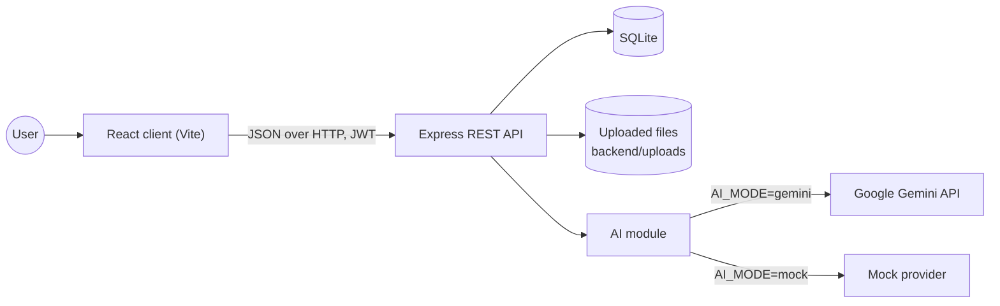
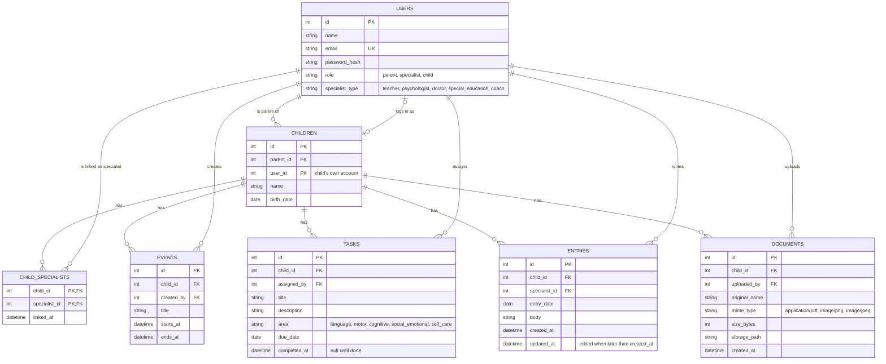
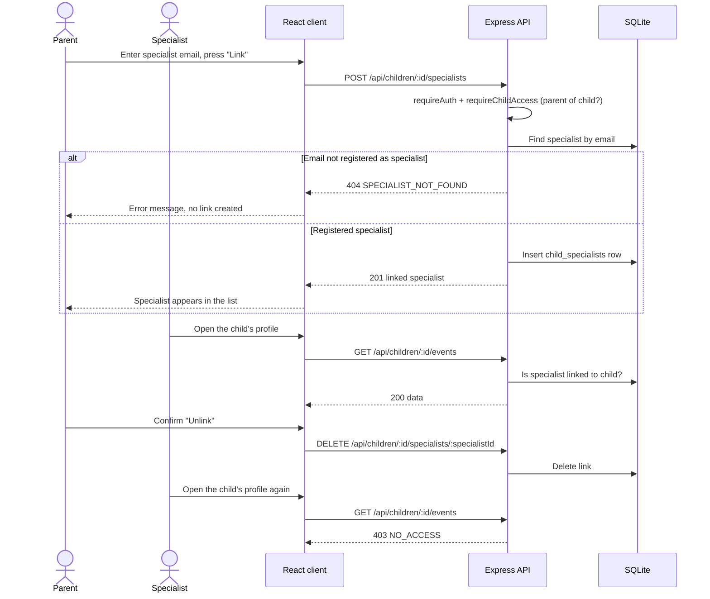
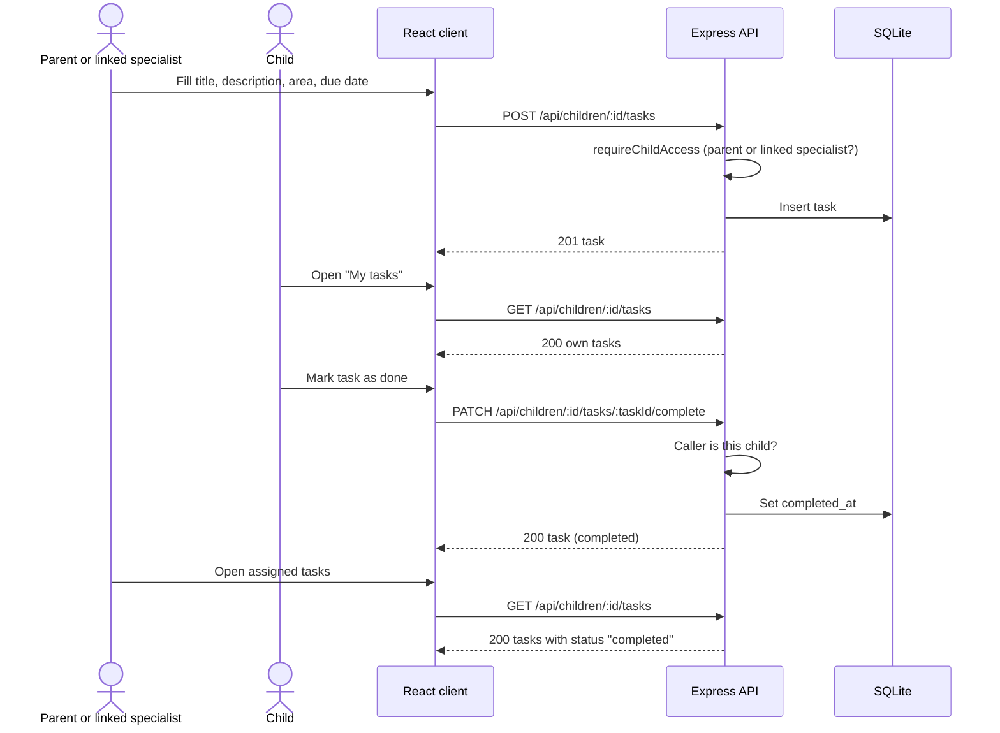
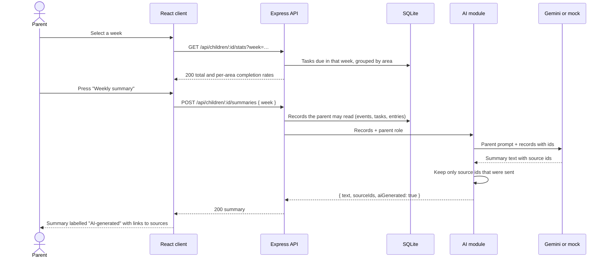

# Software Design Document (SDD)

**Team name:** SENG383-SECTION1-Yigit-Beyzanur
**Version:** ☑ First version (Week 6) ☐ Final (Week 10)
**Last updated:** 2026-11-08

This document describes how the system is built; [SRS.md](SRS.md) describes what it does. Requirement IDs (FR-…) refer to the SRS.

**Status at v0.0:** the walking skeleton contains the React client, the Express API with `GET /api/health` and a temporary `GET /api/demo/summary`, and the SQLite tables `users`, `children` and `child_specialists` with a seed script. Everything else in this document is the planned design for v0.1 (M1–M4) and v0.2 (M5–M8).

---

## 1. Architecture Overview

The system is a three-tier web application: a React single-page client, an Express REST API and a SQLite database. All business rules and access checks run in the API; the client only displays what the API returns. The AI summary is produced by one backend module that calls the Gemini API, or a mock provider in tests and CI, and it only receives records the requesting user may see.

During development, the Vite dev server forwards `/api` requests to the API on port 3001, so the client and API share one origin.

### Backend layers

| Layer | Folder | Responsibility |
|---|---|---|
| Routes | `backend/src/routes/` | Parse and validate the request, call a service, shape the JSON response |
| Middleware | `backend/src/middleware/` | `requireAuth` (verifies the JWT) and `requireChildAccess` (checks the user's relation to the child) |
| Services | `backend/src/services/` | Business rules per module (linking, tasks, statistics, …) |
| Data access | `backend/src/db/` | SQLite connection, schema and seed script |
| AI | `backend/src/ai/` | Prompt building, provider selection (Gemini or mock), response checks |

### Technology Stack

| Layer | Technology |
|---|---|
| Frontend | React 19, Vite 8 |
| Backend | Node.js (22.9 or later), Express 4, JSON Web Tokens, bcryptjs |
| Database | SQLite through better-sqlite3 |
| AI | Google Gemini API (Flash model, free tier) behind a mockable provider |
| Testing | Jest and Supertest (API), Vitest and Testing Library (client), Playwright (end-to-end) |
| CI | GitHub Actions |

---

## 2. Module Design

| Module | Main components | Implements requirements |
|---|---|---|
| M1 – Login and roles | `routes/auth.js`, `middleware/requireAuth.js`; client: `LoginPage`, role-based routing to `ParentHome`, `SpecialistHome`, `ChildHome` | FR-M1-01 – FR-M1-04 |
| M2 – Linking specialists | `routes/specialists.js`, `services/linking.js`, `middleware/requireChildAccess.js`; client: `SpecialistsPage` | FR-M2-01 – FR-M2-07 |
| M3 – Weekly schedule | `routes/events.js`, `services/events.js`; client: `WeeklySchedule` | FR-M3-01 – FR-M3-05 |
| M4 – Tasks | `routes/tasks.js`, `services/tasks.js`; client: `AssignTaskForm`, `AssignedTasksList`, `MyTasksPage` | FR-M4-01 – FR-M4-09 |
| M5 – Specialist entries | `routes/entries.js`, `services/entries.js`; client: `EntriesPanel`, `EntryForm` | FR-M5-01 – FR-M5-06 |
| M6 – Documents | `routes/documents.js` (multer upload), `services/documents.js`; client: `DocumentsPage` | FR-M6-01 – FR-M6-05 |
| M7 – Weekly statistics | `routes/stats.js`, `services/stats.js`; client: `WeeklyStats` | FR-M7-01 – FR-M7-07 |
| M8 – Role-based AI summary | `routes/summaries.js`, `ai/summary.js`, `ai/providers/gemini.js`, `ai/providers/mock.js`, `ai/prompts/parent.md`, `ai/prompts/specialist.md`; client: `AiSummaryCard` | FR-M8-01 – FR-M8-06 |

### Access control

Every request about a child goes through `requireChildAccess`, which loads the child and determines the caller's relation to it. The rules below are enforced in the API, so hiding a screen in the client is never the only protection.

| Data | Parent (own child) | Linked specialist | Unlinked specialist | Child (self) |
|---|---|---|---|---|
| Child profile | Read | Read | No access | Read |
| Specialist links | Create, read, delete | Read | No access | No access |
| Schedule events | Create, read | Create, read | No access | Read |
| Tasks | Create, read | Create, read | No access | Read, mark own task done |
| Specialist entries | Read all | Create, read; edit own entries only | No access | No access |
| Documents | Upload, list, download | Upload, list, download | No access | No access |
| Weekly statistics | Read | Read | No access | No access |
| AI summary | Request (parent prompt) | Request (specialist prompt) | No access | No access |

Responses: `401` without a valid token, `403` when the user may not access the child or the action, `404` when the resource does not exist, `400` for invalid input. Errors use one shape: `{ "error": { "code": "…", "message": "…" } }`.

### Authentication

- Passwords are stored as bcrypt hashes; the plain password is never stored or logged.
- `POST /api/auth/login` returns a signed JWT (HS256, 8-hour expiry) containing the user id and role. The secret comes from `JWT_SECRET` in `backend/.env`.
- The client sends the token as `Authorization: Bearer <token>`. The role is read from the account, never chosen by the user.

### AI module

- One entry point, `ai/summary.js`, builds the summary for one child and one week.
- It collects only the records the caller may read (using the access rules above) and sends their ids with the text, so the answer can cite its sources.
- Separate prompt files for the parent and specialist roles. Both instruct the model to summarize only, and never to decide, diagnose or recommend treatment.
- `AI_MODE=mock` returns a fixed summary built from the input records; tests and CI always use it, so no API key is needed there. `AI_MODE=gemini` uses `GEMINI_API_KEY` from `backend/.env`.
- The response contains the summary text, the source record ids and an `aiGenerated: true` flag; the client always shows the "AI-generated" label and links to the sources.

---

## 3. Data Model

Tables in **bold** exist at v0.0; the others are added with their modules.

Design decisions:

- **Edited entries (FR-M5-04)** are detected from `updated_at > created_at`; no separate flag or history table is needed for the required scope.
- **Weekly statistics (FR-M7-06)** count tasks whose `due_date` falls in the selected Monday–Sunday week. Completion rate = completed / due × 100. A week with no due tasks shows "no tasks" instead of dividing by zero.
- **Documents** are stored on disk under `backend/uploads/` (ignored by git); the table keeps only metadata. Uploads are limited to PDF, PNG and JPEG, at most 10 MB.
- Deleting a child or user removes their links, events, tasks, entries and documents (`ON DELETE CASCADE`).

---

## 4. API / Interfaces

All endpoints are under `/api`, accept and return JSON (except file upload and download) and, apart from `health` and `auth/login`, require a JWT.

| Method | Endpoint | Description | Module |
|---|---|---|---|
| GET | `/api/health` | API and database status (exists) | — |
| POST | `/api/auth/login` | Log in with email and password, returns a JWT and the user's role | M1 |
| GET | `/api/auth/me` | The logged-in user | M1 |
| GET | `/api/children` | Children the user may access | M1, M2 |
| GET | `/api/children/:childId` | Child profile and the caller's relation (`parent`, `specialist`, `self`) | M1, M2 |
| GET | `/api/children/:childId/specialists` | Linked specialists | M2 |
| POST | `/api/children/:childId/specialists` | Link a registered specialist by email (parent only) | M2 |
| DELETE | `/api/children/:childId/specialists/:specialistId` | Unlink a specialist (parent only) | M2 |
| GET | `/api/children/:childId/events?week=YYYY-MM-DD` | Events of the week starting on the given Monday | M3 |
| POST | `/api/children/:childId/events` | Add an event | M3 |
| GET | `/api/children/:childId/tasks?week=YYYY-MM-DD` | Tasks of the child, optionally one week | M4 |
| POST | `/api/children/:childId/tasks` | Assign a task | M4 |
| PATCH | `/api/children/:childId/tasks/:taskId/complete` | Mark a task done (the child only) | M4 |
| GET | `/api/children/:childId/entries` | Specialist entries | M5 |
| POST | `/api/children/:childId/entries` | Add a dated entry | M5 |
| PATCH | `/api/children/:childId/entries/:entryId` | Edit own entry | M5 |
| GET | `/api/children/:childId/documents` | List documents | M6 |
| POST | `/api/children/:childId/documents` | Upload a PDF or image (multipart) | M6 |
| GET | `/api/children/:childId/documents/:documentId/download` | Download a document | M6 |
| GET | `/api/children/:childId/stats?week=YYYY-MM-DD` | Completion rate in total and by area | M7 |
| POST | `/api/children/:childId/summaries` | Generate the role-based AI summary for a week (`{ "week": "YYYY-MM-DD" }`) | M8 |

---

## 5. Critical Flows

The same three flows as SRS Section 4. Each one gets an end-to-end test.

### Flow 1: Specialist linking and access control

### Flow 2: Task assignment and completion

### Flow 3: Weekly progress review and AI summary

---

## 6. User Interface

The current walking-skeleton screen shows the child profile, linked and unlinked specialists and the status of the client, API and database. Screens for v0.1 follow the example screens in Appendix A of the assignment; wireframes or screenshots will be added under `docs/img/` for the final version.

| Screen | Image | Module |
|---|---|---|
| Walking-skeleton overview (exists) | To be added: `docs/img/overview.png` | — |
| Login | To be added: `docs/img/login.png` | M1 |
| Parent – weekly dashboard (schedule, tasks, entries, statistics, AI summary) | To be added | M3, M4, M5, M7, M8 |
| Parent – linked specialists | To be added | M2 |
| Specialist – child profile and new entry | To be added | M2, M5 |
| Specialist – assign and track tasks | To be added | M4 |
| Child – my tasks and schedule | To be added | M3, M4 |
| Documents | To be added | M6 |

---

## 7. Change Log

| Date | Change | By |
|---|---|---|
| 2026-11-08 | First version | Yiğit Ahmet Hosta |
